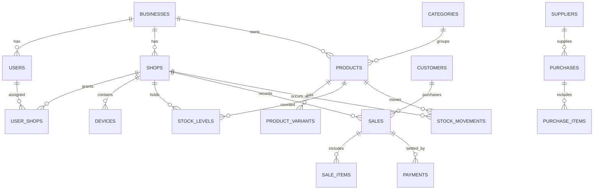

# Architecture

The system is an npm-workspace monorepo: `backend` is an Express/TypeScript API, `dashboard` is an empty React/Vite TypeScript scaffold, and `mobile` is an empty Expo blank TypeScript scaffold. PostgreSQL 16 is the system of record. Render hosts the API, dashboard, and managed database.

## Backend layout

`src/config` validates runtime configuration; `src/db` owns the pool, migrations, and seeds; `src/modules` owns domain routes (health only in this step); `src/middleware` contains cross-cutting HTTP behavior; and `src/utils/tenantScope.ts` is the required query-scoping helper.

## Tenant isolation

1. Every business-data query must apply `tenantScope(auth.businessId)` from the authenticated token. A request-body business ID is never authoritative.
2. Staff queries must also constrain the shop to an assigned `user_shops` record. Owners can query every shop in their business.
3. Future repositories must use `tenantScope`; code review should reject unscoped business-data queries.
4. Database foreign keys protect relationships, but application authorization remains responsible for tenant and shop access checks.

## Data conventions

Money uses integer minor units (`*_minor`), so KES 12.50 is stored as 1250. Inventory quantities use `numeric(14,3)`. Referenced business records are soft-deleted with `deleted_at`. All rows have UUID primary keys and creation/update timestamps. The initial migration creates all schema objects; application code must never apply ad-hoc schema SQL.

Offline-capable records (`products`, `customers`, `sales`, `sale_items`, `payments`, and `stock_movements`) have `client_id`, `version`, and `device_id`. A later sync endpoint will accept client-generated UUIDs from devices, compare versions, and return the server-approved record/version. Stock movements remain an append-only ledger; `stock_levels` is its cached per-shop quantity.

## Entity relationships

